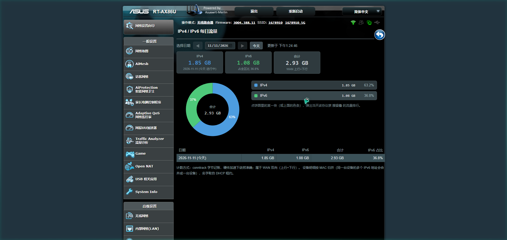

# v6stat — 华硕梅林 IPv4 / IPv6 每日流量统计

一个给 **Asuswrt-Merlin（Koolshare 软件中心）** 用的轻量插件：按天把 WAN 流量拆成 **IPv4 / IPv6** 两本账，并用饼图 + 日历 + 按设备明细展示。



## 为什么需要它

路由器自带的几套统计都不区分协议族：

| 工具 | 按天 | 分 v4/v6 | 硬件加速下准确 |
|---|---|---|---|
| Traffic Monitor / Traffic Analyzer | 部分 | ✗ | 部分 |
| IPTraffic（仅老机型） | ✓ | ✗（只 v4，且会自动关 CTF） | ✗ |
| vnstat-on-merlin | ✓ | ✗（只有总量） | ✗（README 明写加速后不准） |
| iftop / nload / darkstat / ntopng | ✗ | 部分 | ✗ |
| **v6stat** | ✓ | ✓ | ✓ |

关键难点是 **HND 平台（AX86U/AX88U/BE 系列）的 Runner / FlowCache 硬件加速**：被加速的连接不走 netfilter，所以 `iptables` / `ip6tables` 计数器只看到握手包——实测下载 50 MB，iptables 只记到 30 KB（0.1%），`/proc/net/snmp6` 同样失真。

本插件改用 **conntrack 字节记账**（`nf_conntrack_acct=1`）作为唯一计量点，硬件加速下依然完整。实测 45 秒窗口脚本计数与 `/proc/net/dev` 的偏差在 ±3% 以内（105% 左右是含 TCP/IP 头的正常现象）。

## 功能

- **每日 IPv4 / IPv6 流量**，按天累计成 CSV，保留最近 31 天
- **环形饼图**：两族占比，中心显示当日合计
- **日期选择**：日历框 + 前后翻页 + 「今天」，表格行也可点选
- **按设备明细**：点饼图扇区或图例，弹出当天该协议族的设备排行（名字 / MAC / 流量 / 占比 / 进度条）
  - 同一台设备的多个 IPv6 地址按 MAC 合并
  - 名字取自 dnsmasq 租约，没有租约就显示 MAC
  - 路由器自身走 WAN 的流量单列「路由器」
  - 组播 / 广播 / 链路本地（fe80）已过滤
- 每分钟采样一次，页面每 60 秒自动刷新

## 工作原理

```
/etc/crontab (cru)
  └─ 每分钟: v6stat.sh sample
       ├─ 读 /proc/net/nf_conntrack（含 acct 字节数）
       ├─ 按 五元组+id 取「本轮最大值」，与上一轮比对得到增量
       │    ├─ 计数器回绕/重置时（增量<0）取当前值兜底
       │    ├─ 首轮只建基线，不把历史连接一次性计入
       │    └─ 排除 LAN↔LAN、私网↔私网、组播/广播
       ├─ 按族累加到 /tmp/v6stat_rt/totals
       ├─ 把每条流的本端地址归到设备（v4 看私网侧，v6 比对 br0 的 /64 前缀）
       └─ 每 10 分钟落盘；跨天时把昨日合计写入 CSV 并归零
```

两个容易踩的细节（都已处理）：

- conntrack 里 IPv6 是 `240e:03a3:…` 四位补零写法，`ip` 命令是 `240e:3a3:…`，不做归一化会全部匹配失败。
- 同一条流可能在表里出现多条（例如 icmp 的 id 不同），逐条累加会重复计数，所以先在数组里取 `max` 再比对。

## 安装

### 1. 打包

```sh
./build.sh          # 生成 dist/v6stat.tar.gz
```

### 2. 在路由器上离线安装

1. 浏览器打开 `http://路由器IP/`，进入 **软件中心 → 离线安装**
2. 上传 `v6stat.tar.gz`，等安装脚本执行完

安装脚本会做：

- 写入 `/koolshare/scripts/v6stat.sh`、`/koolshare/webs/Module_v6stat.asp`、`/koolshare/res/icon-v6stat.png`
- 生成开机钩子 `/koolshare/init.d/V99v6stat.sh`（开机重新挂 cron）
- 注册 dbus 键 `softcenter_module_v6stat_*`，软件中心里就会出现入口
- 立刻开始采样

> 用命令行装的话，先 `dbus set soft_name=v6stat.tar.gz`（**要带 `.tar.gz` 后缀**），再跑 `/koolshare/scripts/ks_tar_install.sh`；只写 `v6stat` 会报「没有找到任何离线安装包」。

### 3. 卸载

软件中心里点卸载，或直接 `sh /koolshare/scripts/uninstall_v6stat.sh`（安装时会释放到该路径）。卸载会清掉 cron、dbus 键、四个插件文件、`/jffs/traffic` 历史数据、`/tmp` 运行时文件，**不留残留**。

## 数据文件

| 路径 | 内容 | 写入频率 |
|---|---|---|
| `/jffs/traffic/v6stat-daily.csv` | `日期,IPv4字节,IPv6字节`，保留全部历史 | 每天 1 行 |
| `/jffs/traffic/dev/<日期>.csv` | `设备ID,协议族,字节,名字` | 每 10 分钟 |
| `/jffs/traffic/v6stat.state` | 当日累计值（重启后恢复用） | 每 10 分钟 |
| `/jffs/.koolshare/res/v6stat-data.json` | 页面读取的汇总 + 设备明细 | 每 10 分钟 |
| `/tmp/v6stat_rt/` | 运行时中间态（内存盘，不写闪存） | 每分钟 |

## 性能与闪存写入

在 RT-AX86U（4 核 A53）实测：

- 单次采样 ≈ 0.28 秒 CPU（钟表时间 0.28 秒），每分钟一次 → **单核约 0.5%**
- 常驻内存基本为 0（awk 处理完即退出），`/tmp` 运行时文件约 55 KB
- **闪存写入 ≈ 0.55 MB/天（约 200 MB/年）**，净占用约 1 KB/天（只有 CSV 在增长）

`/jffs` 只有几十 MB，长期跑建议留意剩余空间；也可以用 U 盘挂载点替换 `DIR`。

## 已知限制

- 设备明细从**安装当天**开始记录，历史日期没有明细（页面上会提示）
- 数据源最多滞后 10 分钟，页面顶部显示的是「数据时间」而不是请求时间
- v6 隧道（6in4 / 6rd）会把同一份流量记两次
- 双 WAN 只统计默认 WAN（`nvram get wan0_ifname` 推导，PPPoE 下是 `ppp0`）
- 极短的 UDP 流可能在两次采样之间就结束，被漏掉（conntrack 有 TIME_WAIT 缓冲，实际影响很小）
- 仅测试于 RT-AX86U + Asuswrt-Merlin 388.11（Koolshare 改版）；理论上其它 HND 机型通用

## 兼容性

- 梅林固件（含 Koolshare 软件中心改版），需开启 JFFS 自定义脚本
- 需要 `conntrack` 的 `acct` 支持（`/proc/sys/net/netfilter/nf_conntrack_acct`），插件会自动置 1
- 页面依赖软件中心自带的 `state.js` / `jquery.js` / `softcenter.js`

## License

MIT
